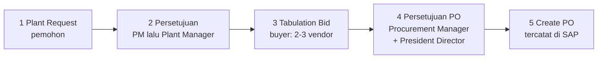

# Manual Penggunaan untuk Tester — Semua Modul

**Versi 1.3 — 26 November 2026**
Pendamping dokumen *Brief Uji Coba Menyeluruh PMB*. Kata sandi seluruh akun uji: `password`.

## Cara memakai manual ini

Setiap modul ditulis dengan urutan yang sama, supaya kamu bisa bekerja tanpa membaca dari atas:

- **Apa gunanya** — maksud modul dalam satu-dua kalimat.
- **Siapa yang menguji** — akun yang berhak, dan akun yang seharusnya ditolak.
- **Langkah mencoba** — yang bisa langsung dikerjakan di layar.
- **Hasil yang diharapkan** — pembanding untuk menilai apakah perilakunya benar.
- **Catat apa** — hal yang paling sering menjadi temuan pada modul itu.

Label tombol dan menu ditulis apa adanya sesuai layar (dalam bahasa Inggris). Kerjakan modul sesuai jadwal kelompokmu; bila selesai lebih cepat, lanjutkan ke modul berikutnya pada daftar yang sama.

## Bagian A — Persiapan

### A1. Masuk ke PMB

1. Buka peramban (Chrome atau Edge), lalu buka **`https://pmb.arka-acc.online`** (bisa dari jaringan kantor maupun dari luar).
2. Pada kolom pertama, isi **username** (misalnya `adminproc`) **atau email** (misalnya `procurement.admin@pmb.demo`). Keduanya diterima; huruf besar dan kecil sama saja.
3. Isi kata sandi: `password`.
4. Tekan tombol masuk. Sebelum halaman masuk tampil, ada panel **"What's new"** yang boleh dibaca untuk melihat apa yang baru di aplikasi.

**Bila gagal:** PMB membatasi 5 percobaan per menit. Pesan "These credentials do not match our records." muncul untuk kata sandi salah maupun akun yang tidak ada. Tunggu satu menit, lalu coba sekali lagi dengan hati-hati.

### A2. Mengenal layar

| Bagian layar | Keterangan |
|---|---|
| Sidebar kiri | daftar menu; menu yang sedang dibuka ditandai |
| Bar atas | pemilih proyek dan tombol keluar |
| Lencana pada menu Approvals | jumlah dokumen yang menunggu persetujuanmu |
| Tabel data | setiap kolom bisa diurutkan; di atas tabel ada kotak pencarian dan penyaring |
| Tombol ekspor | tersedia pada beberapa daftar dan seluruh laporan, dengan pilihan CSV atau PDF |

### A3. Tiga hal yang berlaku di semua modul

1. **Hak akses mengikuti peran.** Bila sebuah menu tidak muncul untuk peranmu, itu memang disengaja. Menguji *penolakan* juga bagian dari tugas: pastikan yang seharusnya tidak boleh memang tidak bisa.
2. **Pemilih proyek di bar atas** menentukan halaman mana yang tersaring. Yang mengikuti: Dashboard, Budget, Plant Requests, DMBD, Reports. Halaman pengadaan menampilkan seluruh dokumen dan disaring lewat kolom **Project**.
3. **Angka menyusul, bukan langsung.** Status dokumen berubah seketika, tetapi angka *aktual* pada pagu baru terisi setelah dokumen dari sistem lain terbaca (penarikan berkala setiap 15 menit). Ini bukan kesalahan hitung.

## Bagian B — Modul per modul

### B1. Dashboard

**Apa gunanya.** Ringkasan keadaan hari itu: pagu terpakai, permintaan yang disetujui bulan ini, pembandingan vendor yang menunggu, dan status unit.

**Siapa yang menguji.** Semua peran. Bandingkan isi dashboard antarperan: **dashboard Plant Manager tidak boleh menampilkan proyek lain.**

**Langkah mencoba.**

1. Masuk sebagai `planner`, buka **Dashboard**. Catat angka pada kartu **Ceiling**, **Approved This Month**, **Bids Awaiting Review**, **Bids Awaiting PO**, **Breakdown**, **Cancellation**, **DMBD Today**.
2. Masuk sebagai `plant.manager`, buka Dashboard lagi, lalu ganti proyek di bar atas.
3. Masuk sebagai `adminproc`, buka Dashboard dan bandingkan angkanya.

**Hasil yang diharapkan.** Angka berubah sesuai proyek yang dipilih; kartu tidak menampilkan dokumen proyek lain untuk peran plant; tombol **Open Budget** membuka halaman Budget pada proyek yang sama.

**Catat apa.** Angka yang tidak berubah saat proyek diganti, kartu yang kosong tanpa penjelasan, atau angka yang tidak masuk akal (misalnya pemakaian melebihi pagu tanpa penanda).

### B2. Budget

**Apa gunanya.** Pagu per proyek per bulan, beserta komitmen dan pemakaiannya.

**Siapa yang menguji.** `finance.director` (menetapkan pagu), `plant.manager` dan `project.manager` (membaca), `adminproc` (membaca).

**Langkah mencoba.**

1. Masuk sebagai `plant.manager`, buka **Budget**. Perhatikan kolom **Ceiling, Carry Fwd, Committed, Actual, Remaining, % Used, Tolerance**.
2. Cocokkan satu proyek: apakah **Remaining** masuk akal terhadap **Ceiling** dikurangi **Committed** dan **Actual**?
3. Masuk sebagai `finance.director`. Coba buka halaman penetapan pagu (**Set Budget Ceiling** dengan isian **Period Month**, **Project**, **Total Project Budget (IDR)**, **Tolerance (%)**, **Notes (optional)**).
4. Coba tetapkan pagu untuk bulan yang sudah lewat. Amati apakah ditolak dengan penjelasan.

**Hasil yang diharapkan.** Hanya Finance Director yang bisa menetapkan atau mengubah pagu; bulan yang sudah lewat terkunci; perubahan pagu tercatat sebagai penyesuaian, bukan menimpa angka lama tanpa jejak.

**Catat apa.** Peran selain Finance Director yang bisa mengubah pagu, bulan lewat yang masih bisa diubah tanpa penjelasan, atau angka Remaining yang tidak sama dengan pengurangan yang wajar.

### B3. Plant Requests

**Apa gunanya.** Permintaan barang atau jasa dari plant, sebagai titik awal seluruh pengadaan.

**Siapa yang menguji.** Pemohon: `planner`, `mechanic`, `logistic.foreman`, `logistic.pic`. Penyetuju: `project.manager`, lalu `plant.manager`.

**Langkah mencoba.**

1. Sebagai `planner`, buka **Plant Requests**, tekan **Create Request** dan isi formulir (**Create Plant Request**): unit atau peralatan, item yang diminta, jumlah, tanggal dibutuhkan, dan alasan.
2. Simpan. Catat nomor permintaannya.
3. Masuk sebagai `project.manager`, buka **Approvals**, temukan permintaan itu, tekan **Approve**.
4. Masuk sebagai `plant.manager`, setujui langkah kedua.
5. Buka kembali permintaan itu sebagai `planner` — periksa apakah status dan riwayat persetujuannya terlihat.
6. Coba **Reject** pada permintaan lain, dan pastikan alasannya tersimpan serta terlihat oleh pemohon.
7. Coba juga: sebagai `plant.manager`, buka permintaan milik proyek lain. Seharusnya ditolak.

**Hasil yang diharapkan.** Permintaan hanya bisa disetujui oleh peran yang berhak dan berurutan (Project Manager dahulu, lalu Plant Manager); permintaan yang ditolak tidak bisa langsung diajukan ulang tanpa perubahan; pemohon melihat alasan penolakan; batas akses proyek berlaku.

**Catat apa.** Urutan persetujuan yang bisa dilompati, tombol yang tidak muncul untuk peran yang berhak, permintaan yang bisa disetujui dua kali, atau permintaan proyek lain yang ikut terlihat.

### B4. DMBD

**Apa gunanya.** Pencatatan harian status kesiapan unit: siap dipakai, cadangan, atau rusak — sekaligus jalan pintas membuat permintaan perbaikan dari unit yang rusak.

**Siapa yang menguji.** `planner`, `mechanic`, `logistic.pic`.

**Langkah mencoba.**

1. Buka **DMBD**. Cari unit dengan kotak **"Search unit code / description"**.
2. Ubah status satu unit menjadi rusak, isi **Note**, lalu tekan **Save**. Tekan **Cancel** pada unit lain untuk memastikan tidak ada yang tersimpan.
3. Dari unit yang rusak, gunakan tautan untuk membuat permintaan perbaikan (data unit terisi otomatis), lalu simpan.
4. Buka Dashboard dan periksa apakah kartu **Breakdown** dan **DMBD Today** ikut berubah.

**Hasil yang diharapkan.** Perubahan status tersimpan pada tanggal yang benar; permintaan yang dibuat dari DMBD membawa data unit tanpa perlu diisi ulang; ringkasan di Dashboard mengikuti.

**Catat apa.** Status yang kembali sendiri setelah dimuat ulang, unit yang hilang dari daftar, atau data unit yang tidak terisi otomatis pada permintaan.

### B5. Overbudget

**Apa gunanya.** Jalur khusus ketika permintaan melebihi pagu yang tersedia, sehingga tidak bisa dipaksa lewat jalan biasa.

**Siapa yang menguji.** Pengaju: `plant.manager`. Penyetuju: `finance.director`, lalu `operation.director`.

**Langkah mencoba.**

1. Sebagai `plant.manager`, buka **Overbudget**, tekan **New Overbudget Request**.
2. Isi **Plant Request ID**, **Allocation ID**, **Requested amount**, **Over %**, dan **Justification** (misalnya "perbaikan darurat unit produksi"), lalu simpan.
3. Masuk sebagai `finance.director`, setujui dari **Approvals**. Lanjut sebagai `operation.director`.
4. Coba ajukan overbudget tanpa justifikasi — seharusnya ditolak.

**Hasil yang diharapkan.** Persetujuan berurutan Finance Director lalu Operation Director; nilai dan persentase kelebihan terlihat oleh penyetuju; permintaan tanpa alasan tidak bisa diajukan.

**Catat apa.** Overbudget yang bisa disetujui satu orang saja, angka kelebihan yang tidak cocok dengan pagu, atau pengajuan tanpa alasan yang tetap tersimpan.

### B6. Cancellation

**Apa gunanya.** Pembatalan dokumen pengadaan dengan persetujuan dari dua pihak, dan hanya boleh pada tahap tertentu.

**Siapa yang menguji.** `plant.manager` (pihak plant), `procurement.manager` (pihak pengadaan), `adminproc` (membaca).

**Langkah mencoba.**

1. Pilih satu PO yang statusnya masih dapat dibatalkan, buat pengajuan pembatalan dari sisi plant dengan alasan yang jelas.
2. Masuk sebagai `procurement.manager`, buka **Cancellation**, tinjau dan setujui.
3. Coba ajukan pembatalan untuk PO yang sudah dikirim ke vendor — seharusnya ditolak dengan penjelasan.

**Hasil yang diharapkan.** Pembatalan butuh persetujuan kedua pihak; PO yang sudah dikirim tidak bisa dibatalkan lewat jalur ini; alasan pembatalan tersimpan.

**Catat apa.** Pembatalan yang lolos padahal PO sudah dikirim, atau pengajuan yang hilang setelah disetujui satu pihak.

### B7. Interchange

**Apa gunanya.** Pemetaan part pengganti: nomor part asli (genuine) dengan padanan OEM, supaya pembelian tidak salah kode.

**Siapa yang menguji.** `adminproc` (membuat pemetaan), `plant.manager` (tanda tangan teknis).

**Langkah mencoba.**

1. Sebagai `adminproc`, buka **Interchange**, tekan **Add Mapping**, isi **Genuine P/N**, **OEM P/N**, dan **Material Name**, lalu simpan.
2. Masuk sebagai `plant.manager`, berikan tanda tangan teknis bila tombolnya tersedia untuk peran itu.
3. Coba buat pemetaan dengan nomor part yang sudah punya pasangan — seharusnya ditolak atau diperingatkan.

**Hasil yang diharapkan.** Pemetaan hanya bisa dibuat pihak pengadaan, tanda tangan teknis dari plant tercatat, dan pasangan ganda dicegah.

**Catat apa.** Pemetaan ganda yang lolos, atau tanda tangan yang tidak tercatat meski sudah ditekan.

### B8. Cannibal Requests (Beta)

**Apa gunanya.** Peminjaman part dari unit lain yang tidak beroperasi (kanibalisasi), dengan persetujuan berlapis karena menyangkut aset.

**Siapa yang menguji.** `plant.manager`, `aml.manager`, `operation.director`, `director`.

**Langkah mencoba.**

1. Sebagai `plant.manager`, buka **Cannibal Requests**, tekan **Create Request**, pilih unit sumber dan unit tujuan, isi alasannya, lalu simpan.
2. Jalankan persetujuan berurutan: `plant.manager` → `aml.manager` → `operation.director` → `director`, semuanya dari **Approvals**.
3. Amati apakah setiap langkah menampilkan siapa yang sudah menyetujui.

**Hasil yang diharapkan.** Empat langkah persetujuan berjalan berurutan; dokumen tidak bisa melompat ke langkah berikutnya sebelum langkah sebelumnya selesai.

**Catat apa.** Langkah yang terlewat, penyetuju yang tidak menerima dokumennya, atau status yang tidak berubah setelah langkah terakhir disetujui. Modul ini masih tahap terbatas — tuliskan juga bila menurutmu tampilannya membingungkan.

### B9. Components (Beta)

**Apa gunanya.** Susunan komponen peralatan (hubungan induk dan anak) sebagai rujukan pencarian part.

**Siapa yang menguji.** `adminproc`, `admin` (IT).

**Langkah mencoba.**

1. Buka **Components** dan telusuri **Component Hierarchy**.
2. Cari satu peralatan yang kamu kenal, lalu buka susunan komponennya.
3. Coba cari komponen yang tidak ada — seharusnya tampil sebagai daftar kosong, bukan halaman galat.

**Hasil yang diharapkan.** Susunan komponen terbaca berjenjang; pencarian kosong tidak menghasilkan galat.

**Catat apa.** Komponen yang hilang, susunan yang salah induk, atau halaman galat saat pencarian kosong.

### B10. Approvals

**Apa gunanya.** Satu tempat untuk semua yang menunggu keputusanmu.

**Siapa yang menguji.** Semua peran penyetuju: `project.manager`, `plant.manager`, `procurement.manager`, `finance.director`, `operation.director`, `director`, `aml.manager`.

**Langkah mencoba.**

1. Masuk sebagai `project.manager`, buka **Approvals**. Catat isi **Pending Approvals**.
2. Buka satu dokumen, baca ringkasannya, isi **Remarks**, tekan **Approve**.
3. Ulangi pada dokumen lain dengan **Reject**, dan pastikan alasannya wajib diisi.
4. Masuk sebagai `plant.manager`, lalu coba buka dokumen yang menunggu peran lain — seharusnya tidak bisa.
5. Pindah ke bagian **My Approvals** untuk melihat yang sudah kamu putuskan.

**Hasil yang diharapkan.** Setiap penyetuju hanya menerima dokumen pada langkahnya; lencana jumlah pada menu Approvals berkurang setelah diputuskan; keputusan tercatat dengan waktu dan nama.

**Catat apa.** Dokumen yang muncul untuk peran yang salah, keputusan yang bisa diubah setelah disetujui, atau lencana yang tidak ikut berkurang.

### B11. Tabulation Bids

**Apa gunanya.** Membandingkan penawaran dua sampai tiga vendor sebelum PO dibuat.

**Siapa yang menguji.** `buyer` (menyusun), `procurement.manager` (menilai), `adminproc` (membuat PO), `director` (menyetujui PO di atas batas).

**Langkah mencoba.**

1. Sebagai `buyer`, buka **Tabulation Bids**, tekan **Create Bid**, lalu isi **SAP PR ID** dan data tiap vendor: **Vendor Code**, **Vendor Name**, **Price**, **Payment Terms**, **Stock Availability**, **Remarks**.
2. Simpan, lalu kirim untuk dinilai bila tombolnya tersedia.
3. Masuk sebagai `procurement.manager`, buka **Tabulation Bids** lalu halaman **Review**, dan setujui.
4. Sebagai `adminproc`, buka halaman **Review** yang sama dan tekan **Create PO** — tetapi coba juga menekannya **sebelum** persetujuan selesai: harus muncul penjelasan apa yang masih ditunggu.
5. Bila nilai PO melewati batas President Director, masuk sebagai `director` dan setujui.

**Hasil yang diharapkan.** Perbandingan vendor tersimpan; **Create PO** hanya aktif setelah persetujuan selesai; PO yang terbentuk tercatat di SAP (DB LAB) dan muncul di register Purchase Orders.

**Catat apa.** Tombol **Create PO** yang aktif padahal persetujuan belum selesai, harga vendor yang tidak tersimpan, atau PO yang tidak muncul di register setelah dibuat.

### B12. Purchase Orders

**Apa gunanya.** Register seluruh Purchase Order, termasuk riwayat dari aplikasi lama, dengan lampiran, komentar, dan jejak persetujuan.

**Siapa yang menguji.** `adminproc`, `buyer`, `procurement.manager`. Peran plant hanya melihat proyeknya sendiri.

**Langkah mencoba.**

1. Buka **Purchase Orders**. Catat jumlah dokumen di bagian bawah daftar (saat uji dimulai: 11.480 dokumen, dokumen terbaru 23 November 2026).
2. Gunakan **"Search PO, PR, vendor, item code"** untuk mencari nomor PO yang kamu kenal.
3. Saring dengan **Project**, **Department**, **Delivery status**, dan **Origin**.
4. Buka satu PO. Periksa bagian **Line items**, **Attachments**, **Comments**, **Related documents**, dan **Legacy approval history (proc-app)**.
5. Tekan **Follow**, lalu aktifkan **"Only POs I follow"** untuk melihat apakah dokumen itu muncul.
6. Tulis komentar memakai **"Write a comment. Use @ to mention colleagues."** dengan menyebut seorang rekan.
7. Unduh daftar sebagai CSV, lalu buka hasilnya di Excel.
8. Sebagai `plant.manager`, coba buka PO proyek lain — seharusnya ditolak.

**Hasil yang diharapkan.** Pencarian menemukan dokumen lama maupun baru; bagian rincian menampilkan baris item dan lampiran yang benar; komentar dan sebutan tersimpan; penyaring **Following** bekerja; batas akses proyek berlaku.

**Catat apa.** Dokumen lama yang baris itemnya kosong, lampiran yang tidak bisa diunduh, komentar yang hilang setelah halaman dimuat ulang, atau PO proyek lain yang bisa dibuka peran plant.

### B13. Purchase Requests

**Apa gunanya.** Register seluruh Purchase Request, termasuk riwayat, dengan penanda dokumen mana yang sudah menjadi PO.

**Siapa yang menguji.** `adminproc`, `buyer`, `plant.manager` (membaca proyeknya sendiri).

**Langkah mencoba.**

1. Buka **Purchase Requests**. Catat jumlah dokumen dan nilainya (saat uji dimulai: 14.911 dokumen, Rp 14,7 miliar, dokumen terbaru 23 November 2026).
2. Cari dengan **"Search PR, MR, requester, item code"**.
3. Saring dengan **Project**, **Department**, **PR status**.
4. Buka rincian satu PR: periksa baris item, dokumen terkait, dan lampirannya.
5. Unduh daftar sebagai CSV.

**Hasil yang diharapkan.** PR lama dan baru muncul berdampingan; status PR sesuai kenyataan; ekspor CSV memuat baris yang sama dengan yang tampil.

**Catat apa.** PR yang hilang, nilai yang berbeda antara daftar dan rincian, atau ekspor yang jumlah barisnya berbeda dari daftar.

### B14. Daily PR

**Apa gunanya.** Jumlah permintaan per tanggal, untuk pemeriksaan pagi.

**Siapa yang menguji.** `adminproc`, `procurement.manager`.

**Langkah mencoba.**

1. Buka **Daily PR**. Perhatikan jumlah per tanggal, termasuk hari-hari terakhir.
2. Buka satu tanggal dan periksa daftar dokumennya.
3. Unduh CSV-nya dan cocokkan jumlahnya dengan yang tampil.

**Hasil yang diharapkan.** Angka per tanggal konsisten antara daftar, rincian tanggal, dan CSV.

**Catat apa.** Tanggal yang jumlahnya tidak cocok, atau tanggal yang hilang padahal ada dokumennya.

### B15. Suppliers

**Apa gunanya.** Daftar vendor yang dipakai bersama SAP.

**Siapa yang menguji.** `adminproc`, `buyer`.

**Langkah mencoba.**

1. Buka **Suppliers**. Cari dengan **"Search card code or name"**.
2. Periksa satu vendor yang kamu kenal: kode, nama, dan status aktifnya.
3. Jalankan penyegaran dari SAP bila tombolnya tersedia, lalu cek apakah muncul pesan **"Supplier sync completed"**.
4. Cari vendor yang sudah tidak aktif — seharusnya tampil sebagai tidak aktif, bukan hilang.

**Hasil yang diharapkan.** Daftar berisi 2.395 vendor aktif atau lebih; penyegaran tidak menggandakan vendor; vendor lama ditandai, bukan dihapus.

**Catat apa.** Vendor ganda, vendor hilang setelah penyegaran, atau nama vendor yang berbeda dari SAP.

### B16. Item Prices

**Apa gunanya.** Harga item per vendor, dan riwayat impor harganya.

**Siapa yang menguji.** `adminproc`.

**Langkah mencoba.**

1. Buka **Item Prices**. Cari dengan **"Search item code or vendor"**.
2. Buka halaman **Import item prices**, unggah satu berkas CSV contoh (paling besar 5 MB atau 20.000 baris).
3. Periksa ringkasan di **Import history**: **Rows read, Created, Updated, Unchanged, Failed**.
4. Impor berkas yang sama sekali lagi — seharusnya hasilnya "0 dibuat, 0 diubah, semua tidak berubah".
5. Coba unggah berkas yang bukan CSV — seharusnya ditolak dengan pesan yang jelas.

**Hasil yang diharapkan.** Impor berjalan idempoten (tidak menggandakan); ringkasan angka cocok dengan isi berkas; harga yang lebih baru di PMB tidak tertimpa berkas lama.

**Catat apa.** Baris gagal tanpa penjelasan, harga yang tertimpa padahal lebih baru, atau unggahan salah jenis yang diterima.

### B17. Procurement Settings

**Apa gunanya.** Mengatur batas nilai yang mewajibkan persetujuan President Director.

**Siapa yang menguji.** `adminproc`. Peran lain seharusnya tidak bisa membuka.

**Langkah mencoba.**

1. Buka **Procurement Settings**, periksa bagian **"PO President Director threshold"** dan kolom **"Threshold (IDR)"**.
2. Catat nilai yang berlaku sekarang — jangan diubah tanpa izin koordinator.
3. Masuk sebagai `buyer`, coba buka menu yang sama — seharusnya tidak tersedia.
4. Bila koordinator mengizinkan, ubah batas ke nilai kecil (misalnya seratus ribu), lalu uji apakah PO bernilai di bawahnya cukup disetujui Procurement Manager saja. **Kembalikan nilainya setelah selesai.**

**Hasil yang diharapkan.** Hanya Procurement Admin yang bisa mengubah; perubahan langsung berlaku pada pengajuan berikutnya tanpa perlu aplikasi dihentikan.

**Catat apa.** Perubahan yang tidak berpengaruh, peran lain yang bisa membuka, atau nilai yang kembali sendiri.

### B18. Reports

**Apa gunanya.** Delapan laporan pengadaan dan anggaran, semuanya bisa diunduh.

| Laporan | Isi |
|---|---|
| Budget Consumption | pemakaian pagu per proyek |
| Vendor Performance | kinerja vendor berdasarkan dokumen |
| Equipment Cost | biaya peralatan |
| Purchase Request Status | jumlah dan nilai PR per status dan departemen |
| Purchase Order Trend | jumlah dan nilai PO dari bulan ke bulan, dipisah asal PMB dan SAP |
| Top Suppliers | vendor dengan nilai terbesar beserta pangsanya |
| Approval Turnaround | lama waktu dari PR sampai PO, per departemen |
| PR by Department | jumlah dan nilai PR per departemen dan proyek |

**Siapa yang menguji.** `adminproc`, `finance.director`, `operation.director`.

**Langkah mencoba.**

1. Buka **Reports** lalu **Report List**.
2. Buka **Purchase Order Trend**: periksa apakah angka bulan terakhir sesuai dugaanmu.
3. Unduh laporan itu sebagai **PDF** dan sebagai **CSV**; buka keduanya dan cocokkan angkanya.
4. Ulangi untuk **Top Suppliers** dan **Approval Turnaround**.
5. Masuk sebagai peran tanpa izin ekspor, coba unduh — seharusnya tombolnya tidak tersedia atau ditolak.

**Hasil yang diharapkan.** Angka yang sama antara layar, PDF, dan CSV; pilihan penyaring ikut terbawa ke hasil unduhan; izin ekspor berlaku.

**Catat apa.** Selisih angka antara layar dan unduhan, PDF yang terpotong, atau CSV yang kolomnya bergeser.

### B19. SAP Sync

**Apa gunanya.** Memantau hubungan PMB dengan SAP: kapan terakhir menarik data, dan apa yang gagal.

**Siapa yang menguji.** `admin` (IT), `procurement.manager`, `finance.director`.

**Langkah mencoba.**

1. Buka **SAP Sync** → **SAP Sync Dashboard**. Periksa waktu penarikan terakhir.
2. Tekan **Connection Test** dan pastikan hasilnya berhasil.
3. Buka **Sync Logs** dan periksa apakah ada kegagalan yang belum selesai.
4. Pastikan peran lain (misalnya `mechanic`) tidak bisa membuka menu ini.

**Hasil yang diharapkan.** Waktu penarikan masuk akal (dalam 15–30 menit terakhir); uji koneksi berhasil; log menampilkan kegagalan apa adanya, bukan kosong padahal data tidak bertambah.

**Catat apa.** Penarikan yang tertahan tanpa penjelasan, log kosong padahal angka tidak bertambah, atau peran lain yang bisa membuka.

### B20. Users, Role & Permission, Projects

**Apa gunanya.** Administrasi dasar: siapa yang boleh masuk, apa haknya, dan proyek mana yang berlaku.

**Siapa yang menguji.** `admin` (IT), `adminproc` bila diberi izin.

**Langkah mencoba.**

1. Buka **Users**, tekan **Add User**, isi **Name**, **Email**, **Password**, **Division**, **Project Scope**, dan pilih peran pada pilihan **Role**. Simpan, lalu coba masuk dengan akun baru itu.
2. Buka **Roles & Permissions** dan periksa daftar izin satu peran (misalnya Buyer). Ubah satu izin, lalu periksa akibatnya di akun dengan peran itu.
3. Buka **Projects**: periksa daftar proyek **Active** dan **Inactive**.
4. Coba nonaktifkan satu akun uji, lalu pastikan akun itu tidak bisa masuk — **aktifkan kembali setelah selesai.**

**Hasil yang diharapkan.** Akun baru bisa dibuat dan langsung dipakai; perubahan izin berpengaruh pada menu yang tampil; akun nonaktif ditolak; daftar proyek sesuai kenyataan.

**Catat apa.** Akun baru yang tidak bisa masuk, izin yang tidak berpengaruh sebelum aplikasi dijalankan ulang, atau proyek yang hilang dari daftar.

## Bagian C — Tiga skenario berantai

Skenario ini menguji sambungan antar modul — bagian yang paling sering bermasalah walaupun tiap modul terlihat baik sendirian.

### C1. Dari permintaan sampai PO

1. `planner` membuat Plant Request dan menyimpannya.
2. `project.manager` menyetujui, lalu `plant.manager`.
3. `buyer` membuat Tabulation Bid dari PR tersebut dengan dua vendor.
4. `procurement.manager` menyetujui pembandingan.
5. `adminproc` menekan **Create PO**.
6. Periksa: PO muncul di register **Purchase Orders**, nilainya masuk akal, PR asalnya tertaut pada **Related documents**, dan bila nilai PO melewati batas, `director` menerima dokumen untuk disetujui.

### C2. Permintaan melebihi pagu

1. `planner` membuat permintaan bernilai lebih besar daripada sisa pagu proyeknya.
2. Amati apa yang terjadi: apakah permintaan ditolak, atau diarahkan ke jalur overbudget.
3. Bila diarahkan ke overbudget, lanjutkan: `plant.manager` mengajukan, `finance.director` lalu `operation.director` menyetujui.
4. Periksa apakah pagu dan komitmen setelahnya mencerminkan keputusan itu.

### C3. Pembatalan dokumen

1. Pilih PO yang masih boleh dibatalkan; ajukan pembatalan dari sisi plant.
2. `procurement.manager` menyetujui dari **Cancellation**.
3. Periksa status PO, apakah komitmennya kembali ke pagu, dan apakah jejak pembatalannya terlihat.

## Bagian D — Lembar temuan

Isi satu baris per temuan. Berkas CSV-nya kami sediakan terpisah agar bisa dibuka di Excel.

| No | Tanggal | Nama tester | Modul | Langkah yang dilakukan | Yang diharapkan | Yang terjadi | Tingkat | Tangkapan layar |
|---|---|---|---|---|---|---|---|---|

Tingkat: **Blocker** (pekerjaan berhenti) · **Major** (hasil salah atau berbelit) · **Minor** (mengganggu, ada jalan lain) · **Cosmetic** (tampilan).

Selain temuan, catat juga **hal yang membingungkan** — label yang tidak dimengerti, langkah yang terasa berputar, atau angka yang tidak jelas asalnya. Catatan seperti ini sering menjadi perbaikan yang paling terasa bagi pengguna.

## Bagian E — Istilah

| Istilah | Arti |
|---|---|
| Ceiling | pagu anggaran yang ditetapkan untuk satu proyek pada satu bulan |
| Committed | nilai yang sudah terikat oleh dokumen pengadaan |
| Actual | nilai yang sudah menjadi pemakaian nyata |
| Remaining | sisa pagu |
| Tolerance | batas toleransi kelebihan sebelum dianggap melewati pagu |
| Carry forward | sisa bulan lalu yang dibawa ke bulan berikutnya |
| DMBD | pencatatan harian kesiapan unit |
| Overbudget | jalur persetujuan khusus ketika permintaan melebihi pagu |
| Interchange | pemetaan part pengganti antara nomor asli dan nomor OEM |
| Cannibal | peminjaman part dari unit lain yang tidak beroperasi |
| Tabulation Bid | pembandingan penawaran beberapa vendor |
| GRPO | penerimaan barang di SAP |
| DB LAB | basis data uji SAP (`LAB_SBO_20261124`) yang dipakai saat uji coba, bukan data perusahaan |
| Help desk | `dea.hermes@adikaramulia.co.id` — pertanyaan, temuan, atau permintaan bantuan |
