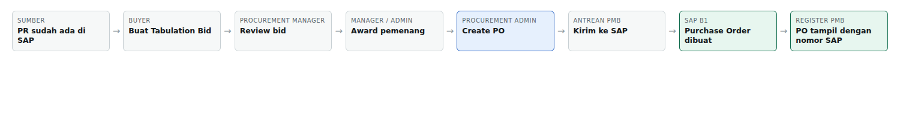
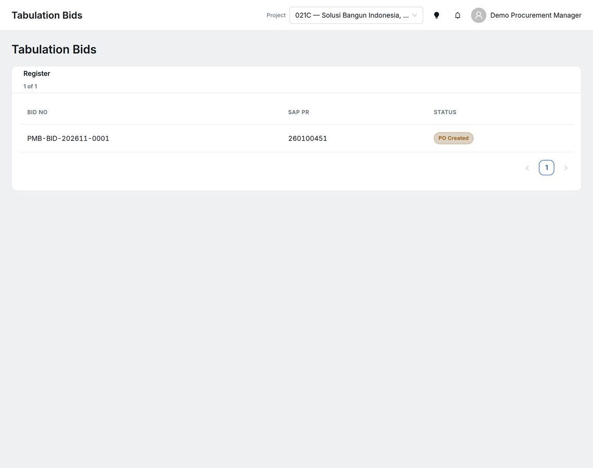
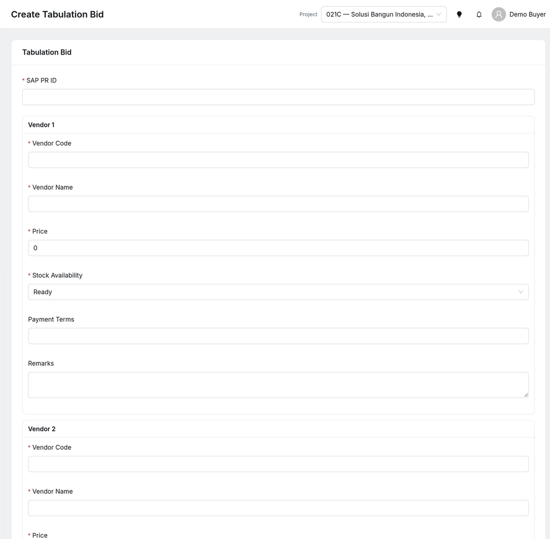
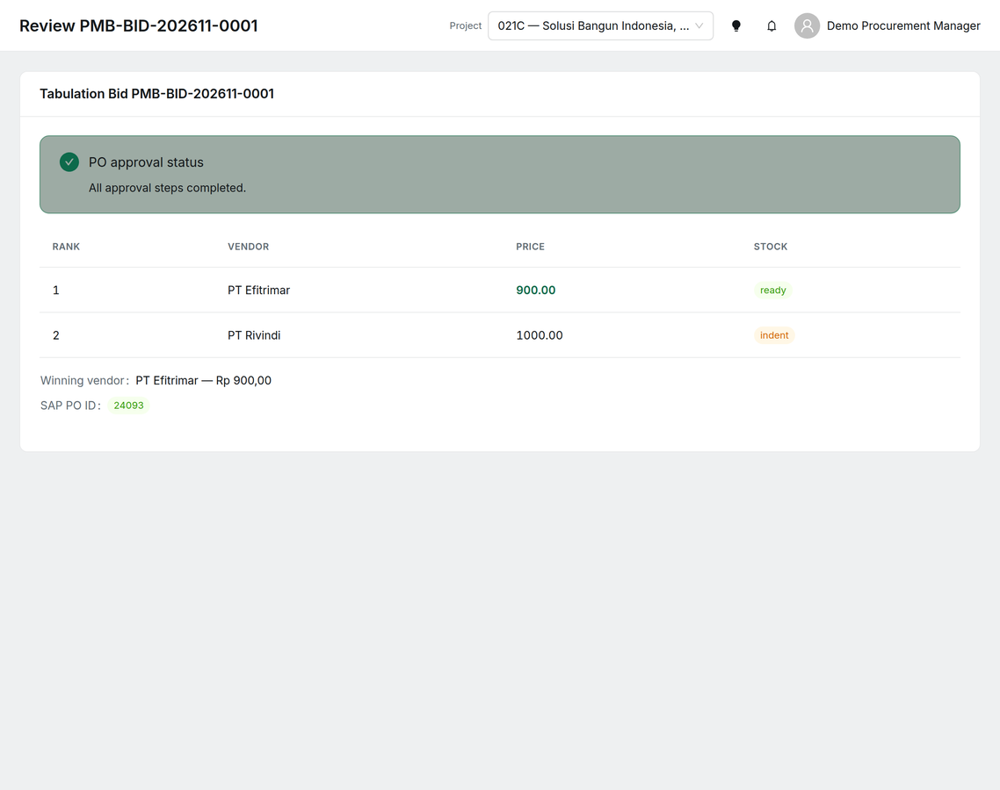
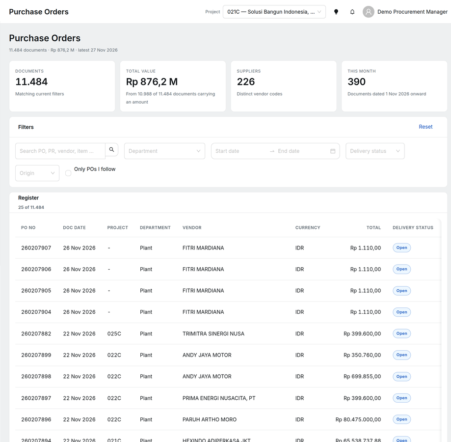
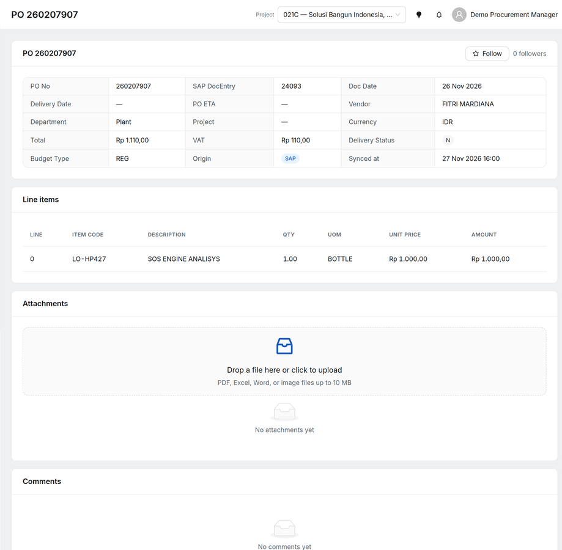

# PMB: Membuat Purchase Order sampai Terkirim ke SAP B1

Panduan langkah demi langkah untuk tim Procurement. Berlaku untuk aplikasi Plant Budget Tracker (PMB) versi 28 November 2026.

Purchase Order di PMB tidak dibuat dari nol. PO lahir dari **Tabulation Bid** yang sudah disetujui dan sudah punya pemenang. Karena itu urutan kerjanya selalu: bid, persetujuan, pemenang, lalu PO.

## Alur singkat

## Siapa mengerjakan apa

| Langkah | Dikerjakan oleh | Tombol atau menu yang dipakai | Hasil |
|---------|-----------------|-------------------------------|-------|
| 1 | Buyer | Menu **Tabulation Bids**, tombol **Create Bid** | Bid baru berstatus draft |
| 2 | Buyer | Kirim bid untuk persetujuan | Bid menunggu Procurement Manager |
| 3 | Procurement Manager | Halaman review bid | Bid diteruskan ke tahap pemenang |
| 4 | Procurement Manager atau Procurement Admin | **Award Lowest** | Pemenang tercatat |
| 5 | Procurement Admin (bukan pembuat bid) | **Create PO** | PO dikirim ke antrean SAP |
| 6 | Semua yang punya akses register | Menu **Purchase Orders** | PO terlihat dengan nomor SAP |

## Sebelum mulai

1. Masuk ke PMB dengan akun yang punya peran sesuai tabel di atas.
2. Pastikan **project context** di topbar sudah menunjukkan proyek yang benar, misalnya `021C`. Semua dokumen yang dibuat akan mengikuti proyek yang aktif di topbar.
3. Siapkan nomor **SAP PR** yang akan dipakai. Bid selalu merujuk ke satu nomor PR, jadi PR harus sudah ada lebih dulu.

## Langkah 1: Buka daftar Tabulation Bid

Buka menu **Tabulation Bids** di bilah kiri. Semua bid yang pernah dibuat tampil di sini beserta nomor bid, nomor PR, dan statusnya.

Perhatikan kolom **Status**. Bid yang siap diproses menjadi PO berada di status yang sudah lolos persetujuan. Kalau bid masih berstatus draft, lanjut ke Langkah 2.

## Langkah 2: Buat Tabulation Bid baru (Buyer)

Klik **Create Bid**. Isi formulir yang muncul.

Yang wajib diisi:

- **SAP PR ID**: nomor PR tujuan, misalnya `260100451`.
- **Vendor** minimal dua, maksimal tiga. Untuk setiap vendor isi **Vendor Code**, **Vendor Name**, **Price**, dan **Stock Availability** (`ready`, `indent`, atau `partial`).

Setelah tersimpan, bid mendapat nomor otomatis dengan pola `PMB-BID-YYYYMM-NNNN`. Kirim bid untuk persetujuan supaya masuk ke meja Procurement Manager.

## Langkah 3: Review dan persetujuan

Procurement Manager membuka bid yang menunggu, lalu memeriksa perbandingan harga vendor. Halaman review menampilkan panel **PO approval status** yang memberi tahu apakah semua langkah persetujuan sudah selesai, atau masih menunggu peran tertentu beserta urutan langkahnya.

Selama persetujuan belum lengkap, tombol pembuatan PO tetap terkunci. Ini pengaman, bukan gangguan: PO tidak boleh dibuat sebelum persetujuan selesai.

## Langkah 4: Tentukan pemenang

Setelah bid berstatus siap pemenang, tombol **Award Lowest** muncul. Tombol itu langsung memilih vendor dengan harga terendah.

Bila ingin memilih vendor yang bukan termurah, pilihan itu harus disertai alasan tertulis. Tanpa alasan, sistem menolak.

Setelah pemenang tercatat, halaman bid menampilkan blok **Winning vendor** berisi nama vendor dan harga yang menang.

## Langkah 5: Create PO sampai masuk SAP

Tombol **Create PO** hanya aktif bila dua syarat terpenuhi: bid sudah punya pemenang, dan seluruh persetujuan sudah selesai. Hanya Procurement Admin yang boleh menekannya, dan admin itu tidak boleh orang yang membuat bid tersebut.

Saat tombol ditekan, PMB menampilkan konfirmasi **Create Purchase Order in SAP?** dengan peringatan bahwa PO yang dibuat adalah dokumen sungguhan di SAP B1. Tekan **Create PO** pada konfirmasi untuk melanjutkan, atau **Cancel** untuk membatalkan.

Sesudah dikonfirmasi, PMB tidak menunggu SAP menjawab di layar. Pekerjaan pengiriman masuk antrean, lalu antrean itu yang mengirim PO ke SAP. Artinya:

- Layar akan kembali ke halaman bid dengan pesan bahwa permintaan sudah dikirim.
- Nomor dokumen SAP muncul setelah antrean selesai, biasanya dalam hitungan detik.
- Kalau antrean gagal, bid tetap tercatat dan pesan galatnya tersimpan untuk diperiksa.

## Langkah 6: Pastikan PO benar-benar masuk

Buka menu **Purchase Orders**. PO yang baru dibuat akan tampil paling atas karena diurutkan menurut tanggal dokumen.

Yang perlu diperiksa pada baris PO baru:

- **PO NO** dan **DOC DATE** sudah terisi.
- **VENDOR** sama dengan pemenang bid.
- **TOTAL** sesuai nilai yang disetujui.
- **PROJECT** sama dengan proyek yang aktif saat PO dibuat.

Klik barisnya untuk melihat rincian item, jumlah, satuan, harga satuan, dan lampiran.

Pada bid sumbernya, nomor SAP PO juga tampil sebagai **SAP PO ID** selama proses berhasil. Contoh dari uji coba: bid `PMB-BID-202611-0001` menghasilkan `SAP PO ID 24093`, dan di register nomor dokumennya `260207907`.

## Kalau PO tidak muncul

Periksa berurutan:

1. **Status bid.** Kalau masih menunggu persetujuan, PO memang belum boleh dibuat.
2. **Pemenang.** Tanpa pemenang, tombol Create PO tidak pernah aktif.
3. **Pesan galat.** Kegagalan pengiriman ke SAP menyimpan pesan aslinya, misalnya penolakan karena data vendor atau kode barang tidak sesuai. Pesan itu yang harus diperbaiki dulu, bukan diulang berkali-kali.
4. **Antrean.** Pengiriman berjalan lewat antrean, jadi jeda beberapa detik itu normal. Kalau lebih dari satu menit belum ada nomor dokumen, laporkan ke tim IT dengan menyebutkan nomor bid dan waktu percobaan.

## Yang tidak boleh dilakukan

- Membuat PO untuk bid yang persetujuannya belum lengkap.
- Menekan **Create PO** dua kali untuk bid yang sama. Sistem menolak PO ganda, tetapi percobaan berulang hanya menambah kebingungan.
- Mengubah pemenang setelah PO terkirim. Perbaikan setelah itu dilakukan lewat pembatalan, bukan dengan award ulang.
- Memakai nomor PR yang berbeda dari yang tercatat di bid.

## Ringkasan dalam satu paragraf

Bid dibuat oleh Buyer dengan merujuk satu nomor PR dan minimal dua penawaran vendor. Procurement Manager me-review dan memastikan persetujuan lengkap, lalu pemenang ditetapkan. Procurement Admin menekan **Create PO**, mengonfirmasi bahwa dokumen akan dibuat di SAP, dan PMB mengirimkannya lewat antrean. Sesudah itu PO dapat dilihat di menu **Purchase Orders** lengkap dengan nomor dokumen SAP.
