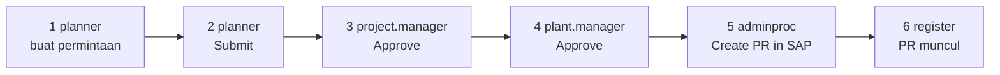

# Skenario Satu Putaran Penuh — Panduan untuk Tester

**Versi 1.0 — 26 November 2026**
Dokumen pendamping: *Brief Uji Coba Menyeluruh* dan *Manual Penggunaan untuk Tester*. Kata sandi seluruh akun: `password`.

## 1. Apa yang akan kamu hasilkan

Satu putaran penuh adalah perjalanan **satu permintaan** dari awal sampai menjadi dokumen di SAP dan kembali terlihat di aplikasi. Di akhir skenario ini kamu akan menghasilkan:

1. Satu **Plant Request** yang sudah disetujui dua tingkat.
2. Satu **Purchase Request (PR)** yang benar-benar jadi di SAP, dengan nomor dokumen.
3. Dokumen yang sama **muncul di register Purchase Requests** di PMB — inilah bukti rantainya nyambung.

Kerjakan berurutan. Jangan lompat langkah, karena setiap langkah memakai hasil langkah sebelumnya.

## 2. Sebelum mulai

| Hal | Keterangan |
|---|---|
| Alamat aplikasi | `https://pmb.arka-acc.online` |
| Akun yang dipakai | `planner`, `project.manager`, `plant.manager`, `adminproc` (kata sandi `password`) |
| Lingkungan | DB uji SAP, bukan data perusahaan — aman untuk mencoba |
| Waktu | ± 10 menit untuk satu putaran, ditambah 1–2 menit menunggu antrean SAP |

Empat akun itu dipakai bergantian. Sebaiknya siapkan empat jendela peramban (atau empat profil) supaya tidak perlu keluar-masuk.

## 3. Urutan singkat

| Langkah | Akun | Menu | Hasil yang diharapkan |
|---|---|---|---|
| 1 | `planner` | Plant Requests → Create Request | permintaan tersimpan sebagai draft, ada nomornya |
| 2 | `planner` | Plant Requests → buka permintaan → Submit | status berubah menjadi menunggu persetujuan |
| 3 | `project.manager` | Approvals → Pending Approvals | langkah 1 disetujui |
| 4 | `plant.manager` | Approvals → Pending Approvals | langkah 2 disetujui, permintaan berstatus approved |
| 5 | `adminproc` | Plant Requests → buka permintaan → Create PR in SAP | PR jadi di SAP, pesan "PR request sent to SAP." |
| 6 | `adminproc` | Purchase Requests → cari nomor PR | dokumen muncul di register dengan nilai dan barisnya |

## 4. Langkah 1 — Buat permintaan (akun `planner`)

1. Masuk sebagai `planner`. Di bar atas, pilih proyek yang kamu pakai (catat proyeknya).
2. Buka menu **Plant Requests**, tekan **Create Request**.
3. Isi formulir **Create Plant Request**:

| Isian | Yang diisi |
|---|---|
| **Select Unit** (cari dengan "Search unit code or description") | pilih satu unit yang muncul di daftar |
| **Unit Code** | terisi mengikuti unit yang dipilih |
| **SAP MR ID** | nomor MR bila kamu punya; untuk latihan boleh angka apa saja, misalnya 12345 |
| **Part Number** | kode barang, misalnya `LO-HP427` |
| **Material Name** | nama barang, misalnya Filter Hydraulic |
| **UOM** | satuan, misalnya PCS |
| **Qty** | 1 |
| **Estimated Price** | 1000 |

4. Perhatikan panel anggaran di samping formulir: **Ceiling (allocation + carry forward)**, **Committed + Actual**, **Project budget remaining**, **Projected Budget Utilization**. Nilai **Estimated Total** harus masuk akal terhadap pagu yang tersisa.
5. Tekan **Save**. Muncul pesan "Plant request draft created."
6. Catat **nomor permintaan** dan **proyek** yang kamu pilih di lembar catatan (bagian 9).

## 5. Langkah 2 — Kirim untuk persetujuan (akun `planner`)

1. Masih sebagai `planner`, buka permintaan yang baru kamu buat (menu **Plant Requests** → **View**).
2. Tekan **Submit**, lalu konfirmasi pada jendela yang muncul.
3. Muncul pesan "Plant request submitted for approval." Status permintaan berpindah dari draft menjadi menunggu persetujuan.

## 6. Langkah 3 — Setujui tingkat pertama (akun `project.manager`)

1. Masuk sebagai `project.manager`.
2. Buka menu **Approvals**. Bagian **Pending Approvals** harus memuat permintaanmu — jumlahnya terlihat juga pada lencana merah di menu Approvals.
3. Buka dokumennya, periksa unit, barang, jumlah, dan nilainya.
4. Isi **Remarks** (misalnya "Uji alur, setuju"), lalu tekan **Approve**.
5. Muncul pesan "Decision recorded." Permintaan berpindah ke langkah berikutnya, dan hilang dari daftar tunggu akun ini.

## 7. Langkah 4 — Setujui tingkat kedua (akun `plant.manager`)

1. Masuk sebagai `plant.manager`.
2. Buka **Approvals** → **Pending Approvals**, temukan permintaan yang sama.
3. Isi **Remarks**, tekan **Approve**.
4. Permintaan sekarang berstatus **approved**. Buka kembali sebagai `planner`: riwayat persetujuan harus terlihat lengkap (siapa, kapan, catatannya).

## 8. Langkah 5 — Buat PR di SAP (akun `adminproc`)

1. Masuk sebagai `adminproc`. Buka menu **Plant Requests** → **View** pada permintaan tadi.
2. Tekan tombol **Create PR in SAP**.
3. Muncul pesan "PR request sent to SAP." Artinya perintah sudah masuk antrean; dokumen dibuat di latar belakang.
4. **Tunggu 1–2 menit**, lalu muat ulang halaman permintaan. Akan muncul:
   - status permintaan menjadi **PR created**,
   - **nomor PR** terisi (format misalnya `260100451`),
   - bagian **Procurement History** mencatat kejadiannya.

> Bila nomor PR belum muncul setelah 3 menit, jangan menekan tombolnya berulang kali — satu tekanan sudah cukup. Catat kejadiannya dan laporkan (bagian 10).

## 9. Langkah 6 — Periksa register (akun `adminproc`)

1. Buka menu **Purchase Requests**.
2. Cari dengan kotak **"Search PR, MR, requester, item code"** memakai nomor PR yang kamu dapat.
3. Dokumen harus muncul dengan nilai dan jumlah baris yang sama dengan yang kamu buat.
4. Buka rinciannya: baris item, lampiran, dan dokumen terkait harus terlihat.

**Dua hal yang wajar dan bukan kesalahan:**

- **Kolom Department kosong** pada PR buatan PMB. SAP hanya mengizinkan departemen diisi dari dalam SAP sendiri, jadi dokumen buatan aplikasi tercatat tanpa departemen.
- **Nomor PR baru muncul beberapa menit setelah** tombol ditekan, karena pembuatan dokumen berjalan di antrean.

## 10. Lembar catatan

Isi sambil mengerjakan; ini yang kami periksa setelah uji coba.

| Hal | Jawabanmu |
|---|---|
| Proyek yang dipilih | |
| Nomor permintaan (Plant Request) | |
| Nomor PR di SAP | |
| Nilai permintaan / nilai PR | |
| Waktu tekan Create PR in SAP | |
| Waktu nomor PR muncul | |
| Apakah PR muncul di register? | |
| Catatan/kejanggalan yang kamu lihat | |

## 11. Contoh hasil nyata (pembanding)

Ini hasil uji yang kami jalankan sendiri pada 26 November 2026 — gunakan sebagai pembanding, bukan target angka:

| Hal | Hasil uji kami |
|---|---|
| Akun pemohon | `planner` |
| Permintaan | nomor 2, status akhir **PR created** |
| Persetujuan | 2 langkah: `project.manager` lalu `plant.manager` |
| Nomor PR di SAP | **260100451** |
| Nilai | Rp 1.000 (1 baris, qty 1 × Rp 1.000) |
| Register | PR tampil di register; jumlah dokumen register bertambah dari 14.911 menjadi 14.912 |
| Kolom Department | kosong (wajar, lihat bagian 9) |

## 12. Bila ada yang tidak berjalan

| Gejala | Penyebab yang paling sering | Yang dilakukan |
|---|---|---|
| Permintaan tidak bisa disimpan | ada isian wajib yang kosong (unit, part number, UOM, qty) | periksa semua isian bertanda wajib |
| Tombol Submit tidak muncul | kamu membuka permintaan milik orang lain, atau status bukan draft | pastikan masuk sebagai `planner` dan permintaan masih draft |
| Permintaan tidak muncul di Approvals | akunmu bukan penyetuju pada langkah itu, atau proyeknya berbeda | pastikan memakai `project.manager` lalu `plant.manager`, dan proyek sama |
| Tombol Create PR in SAP tidak ada | akunmu bukan Procurement Admin atau IT Manager | masuk sebagai `adminproc` |
| Nomor PR belum muncul setelah 3 menit | antrean masih berjalan, atau ada gangguan ke SAP | tunggu, lalu laporkan dengan nomor permintaan |
| PR ada di SAP tetapi tidak muncul di register | penarikan data berkala belum berjalan | tunggu penarikan berikutnya (berkala), lalu periksa lagi |

## 13. Yang perlu dilaporkan

Laporkan ke koordinator uji coba atau ke help desk **dea.hermes@adikaramulia.co.id**, dengan menyebutkan:

1. nomor permintaan dan nomor PR (bila ada),
2. langkah berapa yang gagal,
3. apa yang kamu harapkan dan apa yang terjadi,
4. tangkapan layar.

Satu laporan satu masalah, jangan digabung — supaya bisa kami tindak lanjuti satu per satu.
