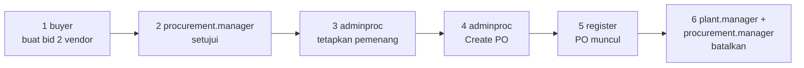

# Skenario Lanjutan — Pembandingan Vendor sampai Pembatalan

**Versi 1.0 — 26 November 2026**
Lanjutan dari *Skenario Satu Putaran Penuh*. Kerjakan skenario itu lebih dulu, karena di sini kamu memakai PR yang sudah kamu hasilkan di sana.

## 1. Apa yang akan kamu hasilkan

Skenario ini menguji bagian yang paling banyak aturannya: memilih vendor, membuat Purchase Order, lalu membatalkannya. Di akhir, kamu akan punya:

1. Satu **Tabulation Bid** yang membandingkan dua vendor, lengkap dengan pemenangnya.
2. Satu **Purchase Order** di SAP hasil dari pembandingan itu.
3. Satu **pembatalan** yang disetujui dua pihak, dengan permintaan berubah menjadi **cancelled**.

## 2. Akun yang dipakai

| Akun | Perannya di skenario ini |
|---|---|
| `buyer` | menyusun pembandingan vendor |
| `procurement.manager` | menyetujui pembandingan dan menyetujui pembatalan |
| `adminproc` | menetapkan pemenang dan membuat PO |
| `plant.manager` | mengajukan pembatalan |

## 3. Bagian A — Pembandingan vendor dan pembuatan PO

### Langkah 1 — Susun pembandingan (akun `buyer`)

1. Masuk sebagai `buyer`, buka menu **Tabulation Bids**, tekan **Create Bid**.
2. Isi **SAP PR ID** dengan nomor PR yang kamu hasilkan di skenario pertama.
3. Isi dua vendor dengan harga berbeda — inilah inti pembandingan:

| Isian | Vendor pertama | Vendor kedua |
|---|---|---|
| **Vendor Code** | `EFITRIMAR` | `VRIVIIDR01` |
| **Vendor Name** | PT Efitrimar | PT Rivindi |
| **Price** | 900 | 1000 |
| **Payment Terms** | 30 hari | 14 hari |
| **Stock Availability** | ready | indent |
| **Remarks** | uji alur | uji alur |

4. Tekan simpan. Muncul nomor pembandingan (contoh: **PMB-BID-202611-0001**) dan statusnya menjadi menunggu persetujuan Procurement Manager.
5. Catat nomor pembandingan itu.

### Langkah 2 — Setujui pembandingan (akun `procurement.manager`)

1. Masuk sebagai `procurement.manager`, buka **Approvals** → **Pending Approvals**.
2. Buka pembandingan tadi, periksa harga kedua vendor.
3. Isi **Remarks**, tekan **Approve**. Statusnya berpindah menjadi menunggu tindakan Procurement Admin.

### Langkah 3 — Tetapkan pemenang (akun `adminproc`)

1. Masuk sebagai `adminproc`, buka menu **Tabulation Bids**, buka pembandingan tadi.
2. Tetapkan pemenang — pilih vendor termurah (**EFITRIMAR**, harga 900).
3. Bila kamu memilih vendor yang **bukan** termurah, sistem akan meminta **justification** (alasan). Coba sekali untuk melihat penolakannya, lalu ulangi dengan yang termurah.

**Catatan pemisahan tugas:** orang yang menyusun pembandingan tidak boleh membuat PO-nya. Itu sebabnya langkah ini memakai `adminproc`, bukan `buyer`.

### Langkah 4 — Buat PO (masih `adminproc`)

1. Pada pembandingan yang sudah punya pemenang, tekan **Create PO**.
2. Tunggu **1–2 menit**: pembuatan dokumen berjalan di antrean, bukan seketika.
3. Muat ulang. Pembandingan berubah menjadi **po_created** dengan nomor PO dari SAP (contoh: `260207907`).
4. Bila kamu menekan **Create PO** sebelum persetujuan selesai, sistem harus menolak dengan penjelasan apa yang masih ditunggu — coba juga ini untuk memastikan penjelasannya jelas.

### Langkah 5 — Periksa register (masih `adminproc`)

1. Buka **Purchase Orders**, cari nomor PO tadi dengan **"Search PO, PR, vendor, item code"**.
2. Dokumen harus muncul dengan vendor pemenang, nilai sesuai harga pemenang, dan status **Plant** pada kolom departemen.
3. Bila belum muncul, tunggu penarikan data berikutnya — register diperbarui berkala.

## 4. Bagian B — Membatalkan dokumen

### Langkah 6 — Ajukan pembatalan (akun `plant.manager`)

1. Masuk sebagai `plant.manager`, buka permintaan yang sudah punya PO.
2. Tekan **Request Cancellation**, isi alasan pembatalan (wajib).
3. Pembatalan tersimpan dengan status **pending**, menunggu persetujuan pihak pengadaan.

### Langkah 7 — Setujui pembatalan (akun `procurement.manager`)

1. Masuk sebagai `procurement.manager`, buka menu **Cancellation**.
2. Temukan pengajuan pembatalan tadi, periksa alasannya, lalu setujui.
3. Status pembatalan menjadi **approved**, dan permintaan berubah menjadi **cancelled**.

**Yang harus ditolak:** pembatalan tidak boleh berhasil bila PO sudah **dikirim** ke vendor. Bila kamu menandai tahap PO sebagai *sent*, sistem harus menolak dengan pesan yang jelas — uji juga ini.

## 5. Lembar catatan

| Hal | Jawabanmu |
|---|---|
| Nomor pembandingan (Tabulation Bid) | |
| Vendor pemenang dan harganya | |
| Nomor PO dari SAP | |
| Waktu tekan Create PO | |
| Waktu nomor PO muncul | |
| PO muncul di register? (ya/tidak) | |
| Pembatalan berhasil? status akhir permintaan | |
| Kejanggalan yang kamu lihat | |

## 6. Contoh hasil nyata (pembanding)

Ini hasil uji yang kami jalankan pada 26 November 2026:

| Hal | Hasil uji kami |
|---|---|
| Pembandingan | **PMB-BID-202611-0001**, dua vendor (EFITRIMAR 900, VRIVIIDR01 1000) |
| Persetujuan | `procurement.manager`, status berpindah ke menunggu Procurement Admin |
| Pemenang | EFITRIMAR (vendor termurah) |
| PO di SAP | **260207907** (DocEntry 24093), nilai Rp 1.110 |
| Register | PO muncul dengan departemen **Plant**, register bertambah |
| Pembatalan | diajukan `plant.manager`, disetujui `procurement.manager`, status **approved** |
| Permintaan | berubah menjadi **cancelled** |

## 7. Bila ada yang tidak berjalan

| Gejala | Penyebab yang paling sering | Yang dilakukan |
|---|---|---|
| Tombol create bid tidak ada | akunmu bukan Buyer atau Procurement Admin | masuk sebagai `buyer` |
| Bid tidak muncul di Approvals | pembandingan sudah disetujui, atau proyek/PR berbeda | periksa status pembandingan |
| Tidak bisa menetapkan pemenang | status belum disetujui Procurement Manager | selesaikan persetujuan lebih dulu |
| Penetapan pemenang ditolak | memilih vendor bukan termurah tanpa alasan | isi justification, atau pilih vendor termurah |
| Create PO ditolak | kamu penyusun pembandingan itu, atau pemenang belum ditetapkan | pakai akun lain (`adminproc`) dan tetapkan pemenang dulu |
| Nomor PO belum muncul | antrean masih berjalan | tunggu 1–2 menit, lalu muat ulang |
| PO belum ada di register | penarikan data berkala belum berjalan | tunggu penarikan berikutnya |
| Pembatalan tidak bisa diajukan | PO sudah berstatus terkirim ke vendor | pembatalan hanya untuk tahap sebelum terkirim |

## 8. Yang perlu dilaporkan

Sama seperti skenario sebelumnya: nomor pembandingan, nomor PO, langkah yang gagal, apa yang diharapkan versus yang terjadi, dan tangkapan layar. Kirim ke koordinator uji coba atau ke help desk **dea.hermes@adikaramulia.co.id** — satu laporan untuk satu masalah.
